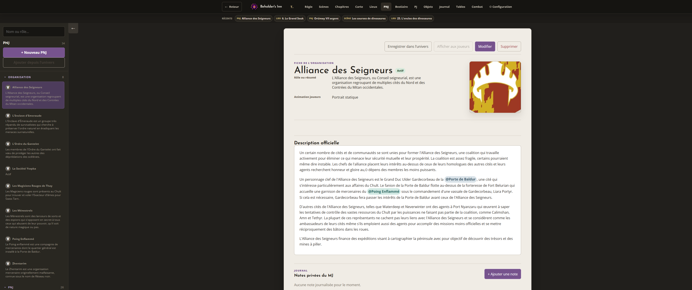

  

<b>English</b> · <a href="./README.fr.md">Français</a>

# Beholder's Inn

**Desktop app for tabletop RPG game masters: prepare your campaign and control the screen shown
to your players.**

> 🧪 **Exploratory project**: Beholder's Inn is first and foremost a way to test what AI can
> build today. The code was written entirely by AI agents, first **Codex**, then
> **Claude Code**. My role: defining the product and the architecture, supervising every step
> and reviewing the generated code.
>
> 🚧 **Work in progress**: the app is usable, but it is still evolving and some features are
> provisional.

  

  

  

*The interface is currently in French.*

## The idea

During a session, the game master juggles notes, NPCs, locations and whatever they want to show
the players. Beholder's Inn brings together campaign preparation and a **second screen dedicated
to the players**, controlled from the GM panel: the GM decides what is displayed, when, and on
which monitor.

Battlemap management (grid, fog of war) is deliberately left to
[Foundry VTT](https://foundryvtt.com/).

## Features

- **Campaigns and universes**: resources shared between campaigns of the same universe;
- **Locations**: hierarchical organization and image gallery;
- **NPCs**: sheets, groups and organizations;
- **Player characters**: GM-oriented sheets and hit point tracking;
- **Chapters and scenes**: ordering, preparation and activation of scenes;
- **Campaign map**: automatic graph view of chapters and scenes;
- **Random tables**: preparation and private rolls;
- **Combat tracker**;
- **Player screen**: control-free display on the monitor of your choice, driven from the GM
  panel;
- **Backup and restore** of your data.

## Download

The Windows installer is available in the
[Releases](https://github.com/Flovermeer/gm-display-manager/releases).

The installer is not signed yet, so Windows SmartScreen may show a warning on first launch. The
[user guide](./user-guide.md) (in French) covers installation and getting started.

## Tech stack

| Layer | Technologies |
|---|---|
| UI | Angular 22 (standalone components, zoneless), SCSS |
| Desktop app | Tauri 2 (Rust) |
| Data | SQLite and file system, through the official Tauri plugins |
| Quality | ESLint (Angular and TypeScript rules, layer boundaries), Angular and Rust tests |
| CI/CD | GitHub Actions: checks on every pull request, Windows installer build (NSIS) and release publishing |

The architecture strictly separates layers: `domain/` depends on neither Angular nor Tauri, and
components never access data directly. These rules are enforced automatically by the linter.

## Working with AI: the approach

This project is also a testing ground for how to steer AI agents:

- **specifications and an implementation plan** written upfront, split into milestones;
- **instructions for the agents** ([`AGENTS.md`](./AGENTS.md)): architecture, conventions,
  boundaries;
- **automated guardrails**: layer-boundary linting, tests and CI on every pull request;
- **human review** of every change before merging.

### What I learned

- **Short, focused sessions.** When a session runs too long, the agent ends up hallucinating and
  the quality of the work drops.
- **A well-scoped context and good initial instructions.** Without explicit guidance, the agent
  tends, for example, to duplicate code rather than factor it into reusable components.
- **A human is still needed.** With the way I currently use these tools, human supervision and
  review remain essential to keep the code consistent and maintainable.

**In short:** the hardest part is not getting AI to write code, but scoping each request
properly and being clear and precise about what you ask for.

## Documentation

All documentation below is in French.

- [`user-guide.md`](./user-guide.md): installation, usage, backup and troubleshooting;
- [`DEVELOPMENT.md`](./DEVELOPMENT.md): prerequisites, running in development, checks;
- [`WINDOWS_RELEASE.md`](./WINDOWS_RELEASE.md): building and publishing the installer;
- [`dm-display-manager-specs.md`](./dm-display-manager-specs.md): product vision;
- [`dm-campaign-display-stack.md`](./dm-campaign-display-stack.md): target architecture;
- [`implementation-plan.md`](./implementation-plan.md): milestones and acceptance criteria;
- [`domain-model.md`](./domain-model.md): domain model and data decisions.

## License

© 2026 Florence Vermeerbergen. All rights reserved.

The source code is published for demonstration purposes. Any reproduction, modification or
redistribution, in whole or in part, requires prior written permission. The installer published
in the Releases may be downloaded and used free of charge for personal use. See
[`LICENSE`](./LICENSE).
