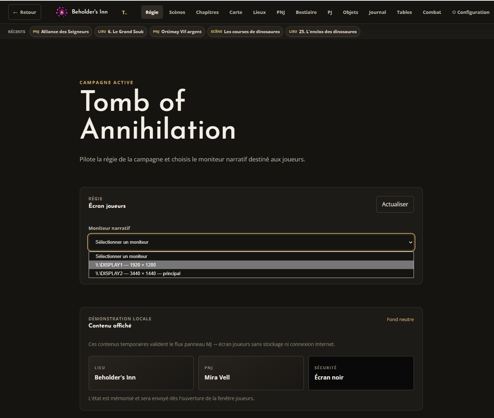
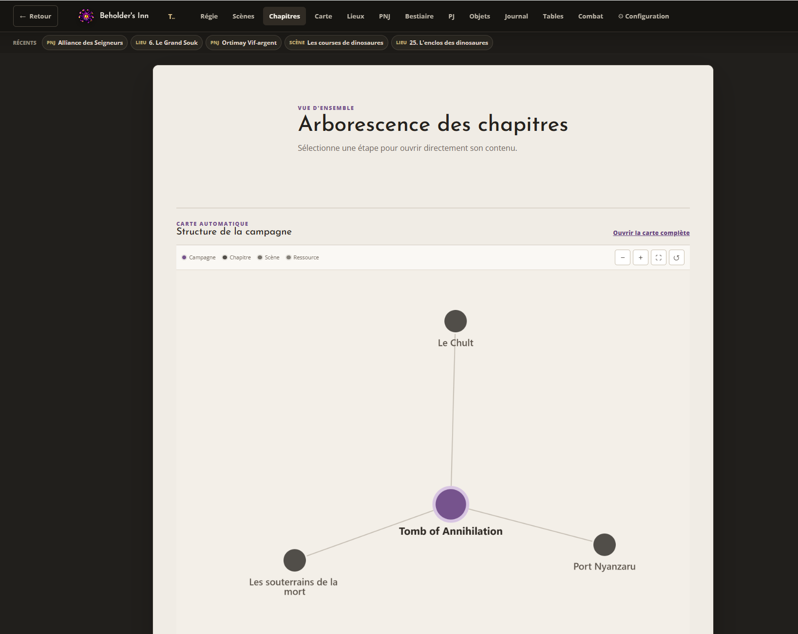

  

# Beholder's Inn

**Application de bureau pour maîtres de jeu de rôle : préparer sa campagne et piloter l'écran
affiché aux joueurs.**

> 🧪 **Projet exploratoire** : Beholder's Inn sert avant tout à tester ce que l'IA permet de
> construire aujourd'hui. Le code a été entièrement écrit par des agents IA, d'abord **Codex**,
> puis **Claude Code**. Mon rôle : définir le produit et l'architecture, superviser chaque étape et
> relire le code produit.
>
> 🚧 **En cours de développement** : l'application est utilisable, mais elle évolue encore et
> certaines fonctionnalités sont provisoires.

  

  

  

## L'idée

Pendant une partie, le maître de jeu jongle entre ses notes, ses PNJ, ses lieux et ce qu'il
veut montrer aux joueurs. Beholder's Inn rassemble la préparation de la campagne et un **second
écran, dédié aux joueurs**, que le MJ contrôle depuis son panneau : il choisit ce qui s'affiche,
quand, et sur quel moniteur.

La gestion de la battlemap (grille, fog of war) reste volontairement confiée à
[Foundry VTT](https://foundryvtt.com/).

## Fonctionnalités

- **Campagnes et univers** : ressources partagées entre les campagnes d'un même univers ;
- **Lieux** : organisation hiérarchique et galerie d'images ;
- **PNJ** : fiches, groupes et organisations ;
- **Personnages joueurs** : fiches utiles au MJ et suivi des points de vie ;
- **Chapitres et scènes** : classement, préparation et activation des scènes ;
- **Carte de campagne** : vue graphique automatique des chapitres et des scènes ;
- **Tables aléatoires** : préparation et tirages privés ;
- **Suivi de combat** ;
- **Écran joueurs** : affichage sans contrôles, sur le moniteur de son choix, piloté depuis le
  panneau du MJ ;
- **Sauvegarde et restauration** des données.

## Télécharger

L'installateur Windows est disponible dans les
[Releases](https://github.com/Flovermeer/gm-display-manager/releases).

L'installateur n'est pas encore signé : Windows SmartScreen peut afficher un avertissement au
premier lancement. Le [guide d'utilisation](./user-guide.md) détaille l'installation et la prise
en main.

## Stack technique

| Couche | Technologies |
|---|---|
| Interface | Angular 22 (composants standalone, zoneless), SCSS |
| Application desktop | Tauri 2 (Rust) |
| Données | SQLite et système de fichiers, via les plugins officiels Tauri |
| Qualité | ESLint (règles Angular, TypeScript et frontières entre couches), tests Angular et Rust |
| CI/CD | GitHub Actions : vérifications à chaque pull request, build de l'installateur Windows (NSIS) et publication de la release |

L'architecture sépare strictement les couches : le `domain/` ne dépend ni d'Angular ni de
Tauri, et les composants n'accèdent jamais directement aux données. Ces règles sont vérifiées
automatiquement par le lint.

## Travailler avec l'IA : la démarche

Ce projet est aussi un terrain d'expérimentation sur la manière d'encadrer des agents IA :

- des **spécifications et un plan d'implémentation** rédigés en amont, découpés en jalons ;
- des **consignes pour les agents** ([`AGENTS.md`](./AGENTS.md)) : architecture, conventions,
  limites ;
- des **garde-fous automatiques** : lint des frontières entre couches, tests et CI sur chaque
  pull request ;
- une **revue humaine** de chaque changement avant fusion.

### Ce que ça m'a appris

- **Des sessions courtes et ciblées.** Sur une session trop longue, l'agent finit par halluciner
  et la qualité du travail baisse.
- **Un contexte bien délimité et de bonnes instructions de départ.** Sans consignes explicites,
  l'agent a par exemple tendance à dupliquer du code plutôt qu'à le factoriser en composants
  réutilisables.
- **Un humain reste nécessaire.** Avec mon utilisation actuelle, la supervision et la relecture
  humaines restent indispensables pour garder un code cohérent et maintenable.

## Documentation

- [`user-guide.md`](./user-guide.md) : installation, utilisation, sauvegarde et dépannage ;
- [`DEVELOPMENT.md`](./DEVELOPMENT.md) : prérequis, lancement en développement, vérifications ;
- [`WINDOWS_RELEASE.md`](./WINDOWS_RELEASE.md) : construction et publication de l'installateur ;
- [`dm-display-manager-specs.md`](./dm-display-manager-specs.md) : vision produit ;
- [`dm-campaign-display-stack.md`](./dm-campaign-display-stack.md) : architecture cible ;
- [`implementation-plan.md`](./implementation-plan.md) : jalons et critères de validation ;
- [`domain-model.md`](./domain-model.md) : modèle métier et décisions de données.

## Licence

© 2026 Florence Vermeerbergen. Tous droits réservés.

Le code source est publié à titre de démonstration. Toute reproduction, modification ou
redistribution, totale ou partielle, nécessite une autorisation écrite préalable.
L'installateur publié dans les Releases peut être téléchargé et utilisé librement à titre
personnel. Voir [`LICENSE`](./LICENSE).
